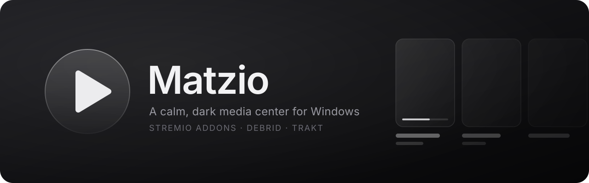

<p align="center">
  
</p>

<p align="center">
  
  
  
  
  
  <a href="https://github.com/matz092024/matzio/actions/workflows/windows.yml"></a>
  
</p>

<p align="center">
  <b>Your Stremio addons, a built-in player, and Trakt, in a quiet glass interface you can look at at 3am.</b>
</p>

<p align="center">
  <a href="#-features">Features</a> ·
  <a href="#-install">Install</a> ·
  <a href="#-run-from-source">Run from source</a> ·
  <a href="#-set-up-your-keys">Keys</a> ·
  <a href="#-keyboard">Keyboard</a> ·
  <a href="#-vibe-coded">Vibe coded</a>
</p>


## ◐ What is Matzio?

Matzio is a desktop media center for Windows in the spirit of [Stremio](https://www.stremio.com). It speaks the Stremio addon protocol, so the addons you already use for catalogs, metadata and streams work here too. Playback is built for **debrid** links: addons hand Matzio a direct HTTP stream and it plays in [mpv](https://mpv.io). There is no built-in torrent engine.

The look is dark, monochrome and frosted glass, with nothing flashing for attention. A **Night dim** switch turns brightness and contrast down further for late-night watching.

## ✦ Features

**Browse**
- **Stremio addons.** Install any addon by its manifest URL, reorder or remove them in Settings. Cinemeta comes preinstalled and can be added back if removed.
- **Home and Discover.** Catalog rows from your addons on Home; Discover for browsing by catalog and searching.
- **Title pages.** Details, cast, seasons and episodes from the addon's metadata.
- **Watchlist.** Save movies and shows to watch later (two-way synced with Trakt when connected).
- **Continue watching.** Picks up movies and episodes where you left off. Play on a series starts the episode you're partway through.

**Play**
- **One-click Play.** Starts the first stream your addons return. Prefer to pick? Set the Play button to **Let me choose**, or open the stream list any time.
- **Loading screen.** While streams are found and the player opens, the title's backdrop and logo fade in over soft outlines. Cancel or `Esc` backs out.
- **Built-in player.** mpv draws right inside the app with Matzio's own controls on top. Prefer mpv's window? Switch **Where video plays** to **Separate window**.
- **Audio and subtitles.** Choose a preferred audio language and subtitle language, show subtitles only when the audio is in another language, and skip SDH (hearing-impaired) tracks. Picking a track in the player updates the preference.
- **Buffer ahead.** A slider from 10 seconds to 10 minutes for how much mpv reads ahead, plus an optional buffer info panel (`I` in the player).

**Sync and upkeep**
- **Trakt.** Finished movies and episodes go to your Trakt history, your watch history and resume points come back, progress is saved on an interval you choose, and the Watchlist mirrors your Trakt watchlist both ways. Works offline: changes are queued and sent later.
- **Artwork from fanart.tv and TMDB.** With keys added under Settings → Connections, title pages and the loading screen use sharper logos, backgrounds and banners from fanart.tv, with TMDB filling the gaps. Without keys, Matzio keeps the art your addons send.
- **Auto-update.** Installed copies check for a new build at launch and every 4 hours, download it in the background, and ask before restarting.
- **Dev mode.** An optional log of errors and playback details to attach to a bug report.

Everything you set up (addons, settings, Watchlist, progress, keys) is saved under `%APPDATA%\Matzio` and survives updates.

## ⤓ Install

1. Open the [latest release](https://github.com/matz092024/matzio/releases/latest) and download **Matzio-Setup.exe**.
2. Run it. Windows may warn because the installer isn't code-signed: click **More info**, then **Run anyway**.
3. In Matzio, go to **Settings → Addons** and paste the manifest URL of your debrid-enabled stream addon.

mpv comes bundled with the installer. From then on Matzio updates itself.

## ⌘ Run from source

You need [Node.js](https://nodejs.org) 22 or newer.

```bash
npm install
npm run fetch-mpv  # optional: downloads mpv for Windows into resources/mpv so the app uses it
npm run dev        # opens the app with live reload
npm run dist:win   # builds a Windows installer into dist/
```

On npm 11+, approve the install scripts once if `npm install` warns about them:

```bash
npm install-scripts approve electron esbuild electron-winstaller
npm rebuild electron esbuild
```

Every push to `main` is built by [GitHub Actions](.github/workflows/windows.yml) on Windows and published as a release, which is what installed copies update from.

### Finding mpv

Matzio looks for mpv in this order: the path in **Settings → Player**, `resources/mpv` (from `npm run fetch-mpv`), your `PATH`, then common install folders. If it isn't found, click **Browse…** in Settings and select `mpv.exe` from the folder you unzipped.

## ⚿ Set up your keys

Keys and sign-ins are kept on your computer, encrypted with Windows' DPAPI, and never committed to this repo.

### Trakt

1. Create an API app at [trakt.tv/oauth/applications](https://trakt.tv/oauth/applications/new). Any name works; set the redirect URI to `urn:ietf:wg:oauth:2.0:oob`.
2. Paste its **Client ID** into **Settings → Trakt**. Apps made since October 2026 have no Client Secret (Trakt shows "Not issued… PKCE"), so leave that field empty; older apps can still paste theirs.
3. Click **Connect Trakt** and approve the code on trakt.tv.

Once connected, every movie or episode you finish (90% watched, the same mark Continue watching uses) is added to your Trakt history. Titles finished while offline are sent later.

The Watchlist is your Trakt watchlist. Adding or removing a title in the app does the same on Trakt right away, and changes made on trakt.tv show up at start-up, every 15 minutes, and on **Sync now**. The first sync after connecting merges both lists without removing anything. Titles Trakt can't match (for example `kitsu:` ids from anime addons) stay in the app only.

<details>
<summary>Build the Trakt keys into the installer instead</summary>

Add `TRAKT_CLIENT_ID` (and `TRAKT_CLIENT_SECRET`, only if your app has one) as repository secrets (Settings → Secrets and variables → Actions). The Windows build passes them in as `MAIN_VITE_TRAKT_CLIENT_ID` and `MAIN_VITE_TRAKT_CLIENT_SECRET`, and Settings then skips the keys step. Locally, the same two variables in a `.env.local` file do this.

</details>

### TMDB and fanart.tv (artwork)

Open **Settings → Connections** and paste your keys:

| Service | Where to get a key | What it accepts |
| --- | --- | --- |
| [TMDB](https://www.themoviedb.org) | [themoviedb.org/settings/api](https://www.themoviedb.org/settings/api) | A v3 API key or a v4 read access token |
| [fanart.tv](https://fanart.tv) | [fanart.tv/get-an-api-key](https://fanart.tv/get-an-api-key/) | A personal API key |

Matzio tests each key before saving it, so a mistyped key is refused rather than stored. Only the last four characters are ever shown back.

Once a key is saved, title pages and the loading screen switch to fanart.tv logos, backgrounds and banners, with TMDB art where fanart.tv has none. fanart.tv finds series only by their TVDB id, so add a TMDB key too if you want series art. Art is cached on disk for a week and refreshed when you change a key.

## ⌨ Keyboard

| Anywhere | | In the player | |
| --- | --- | --- | --- |
| `P` | Play (on a title page) | `Space` / `K` | Pause or resume |
| `/` or `Ctrl + F` | Search | `←` `→` | Skip 10 seconds |
| `1` `2` `3` | Home, Discover, Watchlist | `Shift + ←` `→` | Skip a minute |
| `Ctrl + ,` | Settings | `↑` `↓` | Volume |
| `N` | Night dim on or off | `M` | Mute |
| `Alt + ←` / `Backspace` | Back | `F` | Full screen |
| `Esc` | Close the stream list | `I` | Buffer info on or off |
| | | `Esc` / `Q` | Close the player |

## ◇ Built with

[Electron](https://www.electronjs.org) and [electron-vite](https://electron-vite.org), [React](https://react.dev) and [TypeScript](https://www.typescriptlang.org), [mpv](https://mpv.io) for playback, [electron-updater](https://www.electron.build/auto-update) for updates, and the [Stremio addon protocol](https://github.com/Stremio/stremio-addon-sdk/blob/master/docs/protocol.md).


## ✧ Vibe coded

**This project was fully vibe coded.** Every line of code, every design decision and this README were written by an AI assistant from plain-language requests. Matz described what the app should do and how it should feel, tested the builds on Windows, and said what to change next. No code was written by hand.

<p align="center"><sub>Matzio is not affiliated with Stremio. It plays only what your addons give it; you're responsible for the content you stream.</sub></p>
